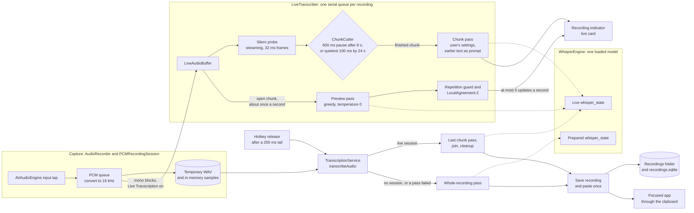

# Dictation pipeline

How a dictation travels from the microphone to the focused app.
It reflects the code on `fix/osw-streaming-build` (live transcription, on top of `c8e6fe7`).
Render it with `Scripts/render_architecture.py`; the HTML it writes is not committed.

Dotted arrows show which decoding state a pass runs on.
With Live Transcription off, which is the default, there is no live session: the recorder hands no blocks to a `LiveAudioBuffer`, the prepared state decodes the whole recording at release, and the indicator shows the compact card.

Live mode also stands down for one recording, which then takes the whole-recording path, when Show Timestamps is on, when the engine is Parakeet, or when the transcription service is busy as recording starts.
If any pass fails, the session frees its state and the recording is decoded whole at release.
Esc, quitting, an engine reload and a recording sent to the queue cancel the session.
